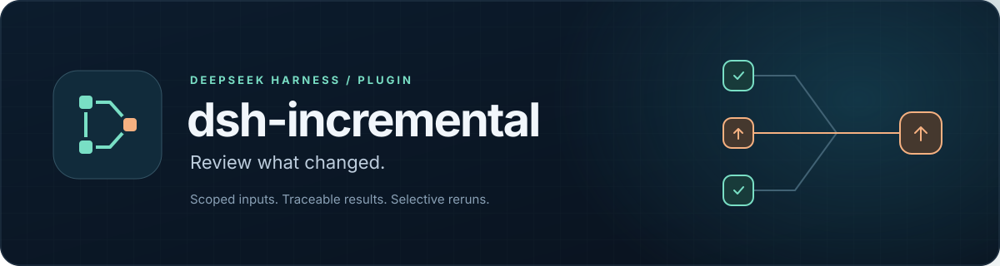
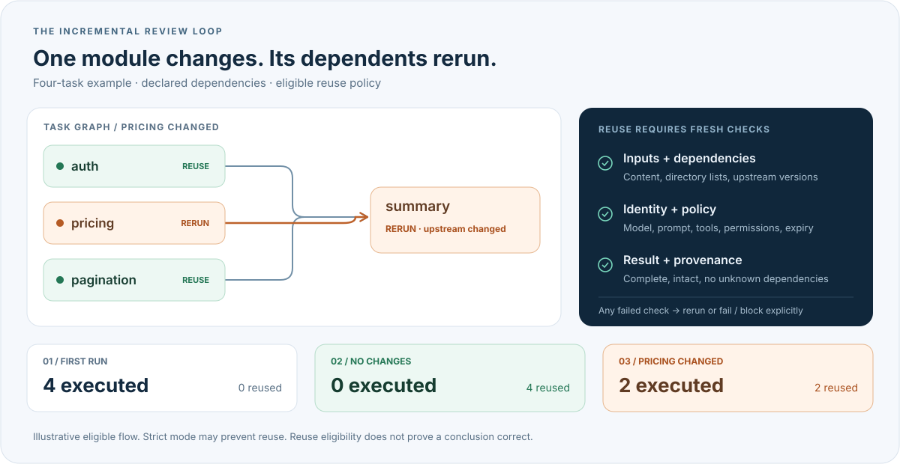

<p align="center">
  
</p>

<p align="center">
  <a href="README.md">简体中文</a> · <strong>English</strong>
</p>

<p align="center">
  <a href="package.json"></a>
  <a href="docs/compatibility.md"></a>
  <a href="docs/compatibility.md"></a>
  <a href="LICENSE"></a>
</p>

<p align="center">
  <strong>Reuse eligible review results. Rerun the tasks affected by change.</strong><br>
  Read-only AI code review for DeepSeek Harness, with traceable inputs and explicit invalidation reasons.
</p>

<p align="center">
  <a href="#quick-start"></a>
  <a href="#how-it-works"></a>
  <a href="docs/core-functionality.md"></a>
  <a href="https://github.com/hg1048596-pixel/dsh-incremental/actions/workflows/test.yml"></a>
  <a href="https://github.com/hg1048596-pixel/dsh-incremental/issues"></a>
</p>

<p align="center">
  <a href="docs/core-functionality.md">Functionality &amp; evidence</a> ·
  <a href="docs/permission-performance.md">Performance</a> ·
  <a href="docs/compatibility.md">Compatibility</a> ·
  <a href="#reuse-rules">Cache rules</a><br>
  <sub>Detailed documentation is currently in Chinese; this README is fully translated.</sub>
</p>

---

A read-only AI incremental review plugin for DSH. It divides a review into tasks with explicit dependencies, saves each task's actual inputs and results, and reuses results only when the inputs, route, permissions, and cache age all qualify. After one module changes, only the affected tasks and their downstream tasks run again.

**Status: the local core functionality has passed acceptance testing with the real DeepSeek API.** The initial four-task run made 4 inference calls; an unchanged run reused every result with 0 inference calls; changing only pricing reran pricing and the summary, with 2 inference calls. This is a functional acceptance test using a small example. Every stage still queries model metadata; these results do not establish general performance or the correctness of review conclusions. See [Core functionality and measured results](docs/core-functionality.md) and [Portable acceptance evidence](docs/evidence/core-acceptance.json).

The compatibility baseline is an existing **DSH 0.1.0-rc.6 / Node 22.23.2** installation on Windows. Compatibility with other DSH versions is not claimed. The plugin does not modify DSH core, run scripts from the repository under review, automatically install models, or switch routes.

<a id="how-it-works"></a>

## How incremental review works

Split a review into tasks with declared inputs, upstream dependencies, and acceptance criteria. Each run checks the inputs and provenance again: eligible results are reused, changed tasks and their downstream tasks rerun, and the report explains each decision.

<p align="center">
  
</p>

The diagram shows a four-task example with `visible-model` enabled and every reuse check passing. Under the default `strict` policy, the current DeepSeek route cannot reuse results across runs because its server revision cannot be verified. **Reuse eligibility does not prove a conclusion correct.** An unchanged run still reads inputs, checks permissions, and queries model metadata on the authorized route.

<a id="quick-start"></a>

## Install into an existing DSH installation

Package this project from its directory, then install the local package through the existing DSH public interface. You do not need to run `npm install` first; the plugin has no build or installation scripts.

```powershell
npm pack --ignore-scripts
dsh plugin --profile incremental-demo add C:\path\dsh-incremental-0.1.0.tgz
```

Replace the path in the second command with the generated tgz file. An unconfigured plugin stays dormant: it does not scan repositories or send requests. Configuration and CLI usage are described below, followed by DSH host configuration.

## Configure real DeepSeek reviews

Copy the [configuration template](examples/dsh-config.example.json) to a private location outside the repository, then update these fields:

- `runtimeRoot`: the `dsh-app` directory containing `package.json` and `node_modules` in an existing DSH installation.
- `approvedRepoRoot`: the absolute path of the repository explicitly approved for sending to this model.
- `model`, `connection`: the pinned model ID, DeepSeek adapter, and API endpoint.
- `credentialEnv`: the name of the environment variable containing the real API key. Supply it to the process through your own credential management method. Do not put the key in configuration, task manifests, or source code.
- `allowRemote`: the template sets this to `false`. Set it to `true` explicitly only after the repository and request route have been authorized.

The template explicitly selects a policy that allows short-term reuse:

```json
"reusePolicy": {
  "mode": "visible-model",
  "maxAgeMs": 86400000
}
```

`visible-model` supports only the direct DeepSeek adapter. Each authorized `plan`, `run`, or `resume` attempts one controlled, authenticated `GET /models` request to the configured endpoint to confirm that the selected model is still advertised. The selected entry's visible metadata, the pinned route, and the executor identity are included in reuse checks. If the query fails or the selected model is not advertised, reuse is disabled and the reason is retained in the report. An ID advertised in a model list **does not prove that a generation used an immutable server-side model version**. A provider update under the same ID may go undetected; selecting this mode means accepting that risk.

`maxAgeMs` is measured from the original result's generation time. A cache hit does not extend its validity. The example lifetime is 24 hours; the configurable range is 1 millisecond to 30 days. After expiry, the model is called again. The lifetime controls reuse only and does not automatically delete saved results. Use `--full` at any time to force every task to run again.

When `reusePolicy` is omitted, the default is `strict`. The current DeepSeek route has no provider-attested immutable model version, so strict mode disables reuse across runs with `model_revision_unknown` and performs a real review on every run. A manually entered version number cannot change this.

## Declare tasks

A task manifest is plain JSON declaring only inputs, dependencies, and review requirements. For example, save this as `C:\private\review.json`:

```json
{
  "schemaVersion": 1,
  "tasks": [
    {
      "id": "auth",
      "description": "Review against this local contract: when roles is an array of strings, only a role exactly equal to admin grants access; return false when the user is missing or roles is not an array. Caller-side filtering and other authorization systems are outside this task's scope. Report only issues supported by the source under this contract, and facts that are both necessary and missing.",
      "inputs": { "files": ["src/auth.js"], "directories": [] },
      "dependsOn": [],
      "acceptance": ["Return observations in the required structure and identify missing context explicitly."]
    },
    {
      "id": "summary",
      "description": "Summarize upstream findings without introducing source code that was not provided.",
      "inputs": { "files": [], "directories": [] },
      "dependsOn": ["auth"],
      "acceptance": ["Preserve the upstream source evidence for every finding."]
    }
  ]
}
```

Input paths are relative to the repository under review. For a complete example, see the [four-task manifest](examples/demo-repo/review-tasks.json) and [example source code](examples/demo-repo/src). Directory inputs recursively include untracked files, hidden files, and empty directories; `.gitignore` is not applied automatically. Declare the files or subdirectories you need to avoid sending credentials or dependency directories along with them.

**A valid cache does not mean the conclusions are correct, or prove that the dependency declarations are complete.** Undeclared files do not invalidate a local cache. Expand the manifest when a task needs more code, environment information, or external material. When the model explicitly reports unknown dependencies, that result and its downstream results are not reused.

Tasks should supply the contracts on which their review conclusions actually depend. Required business rules can be included in the fingerprinted task definition or supplied as declared input files. The example tasks state each module's local contract and scope. Unknown dependencies caused by a missing contract prevent reuse; removing the model's dependency disclosures must not be used to manufacture cache hits.

## Run, reuse, and resume

Run these commands from this project directory, replacing the example paths with your own configuration. The cache state directory must be outside the repository under review.

```powershell
node bin/dsh-incremental.js plan --repo C:\work\sample --manifest C:\private\review.json --state C:\review-state --dsh-config C:\private\review-config.json
node bin/dsh-incremental.js run --repo C:\work\sample --manifest C:\private\review.json --state C:\review-state --dsh-config C:\private\review-config.json
```

The first `run` executes every task. Use the same command on subsequent runs: results that remain valid are marked `reused`, while tasks with changed inputs or upstream results run again. `plan` shows the current invalidation reasons without generating model answers, creating a cache, or holding a write lock. In `visible-model` mode, it still queries model metadata from the authorized endpoint, so it requires credentials and remote authorization.

```powershell
# Force every task to be reviewed again
node bin/dsh-incremental.js run --repo C:\work\sample --manifest C:\private\review.json --state C:\review-state --dsh-config C:\private\review-config.json --full

# Resume a specified run after interruption, rechecking current inputs and upstream versions
node bin/dsh-incremental.js resume --repo C:\work\sample --manifest C:\private\review.json --state C:\review-state --dsh-config C:\private\review-config.json --run-id RUN_ID

# Read a saved report; omit --run-id to read the latest report
node bin/dsh-incremental.js report --repo C:\work\sample --state C:\review-state --run-id RUN_ID
```

Start a new run after changing the manifest. `plan`, `run`, and `resume` all require `--dsh-config`; they do not fall back to a fixture executor. The CLI also supports `--credential-file C:\private\deepseek-key.txt`, which privately reads a UTF-8 file containing a single key, solely for the configured credential reference.

Reports record execution status, invalidation reasons, reuse eligibility, applicability to the current source, model calls and usage, and the checks performed in `validation[]` as separate fields. Missing usage remains unknown; passing structure and evidence checks does not establish that the conclusions are correct. Reused entries preserve their original result provenance. Their original generation checks are retained in `reusedFrom.validation` and are not presented as checks performed again in the current run. Use `--json` for JSON output, or `--output C:\review-output\report.json` to save it outside the repository.

## Use from DSH

Use a host patch to pin the paths, route, and data authorization. For example, save the following as `C:\private\incremental.yml`. Setting `allowRemote: true` means the host has explicitly authorized sending inputs from the configured repository to this route.

```yaml
- id: incremental
  config:
    repoRoot: 'C:\work\sample'
    manifestPath: 'C:\private\review.json'
    stateDir: 'C:\review-state'
    runtimeRoot: 'C:\path\DeepSeek Harness\resources\dsh-app'
    provider: deepseek-official
    model: deepseek-flash
    connection:
      adapter: deepseek
      baseURL: https://api.deepseek.com
      thinking: disabled
      reasoningEffort: off
    credentialEnv: DEEPSEEK_API_KEY
    allowRemote: true
    reusePolicy:
      mode: visible-model
      maxAgeMs: 86400000
    maxRequests: 48
    maxTokens: 4096
    timeoutMs: 120000
```

```powershell
dsh --profile incremental-demo --patch C:\private\incremental.yml
```

The plugin exposes three public tools:

| Tool | Parameters | Purpose |
| --- | --- | --- |
| `incremental_plan` | None | Check which tasks need to run and why. |
| `incremental_run` | Optional `full: true` | Run in the foreground or force a full run. |
| `incremental_report` | Required `runId` | Read a specified saved report. |

Tool parameters cannot change the repository, credentials, model, or authorization. The plugin resolves the configured reference through the existing credentials service, falling back to the corresponding environment variable when that service is unavailable. Runs support cancellation. `background: true` returns an explicit error: the current rc.6 public jobs interface cannot guarantee completion without an extra wake-up of the parent model. The plugin does not initiate follow-up conversations on its own.

<a id="reuse-rules"></a>

## Reuse boundaries

- Every check rereads all declared inputs, using the same bytes for hashing and the request; it does not rely on timestamps or Git status. Checks cover the complete task, directory listings, upstream result versions, actual request, route, executor, prompt and validator identities, permissions, and repository identity.
- Additions, deletions, and renames affect the relevant directory listing. A missing explicitly declared file fails the task and blocks downstream tasks. Paths escaping the approved root, links/reparse points, Windows ADS, invalid UTF-8, read failures, and exceeded limits fail explicitly instead of being silently truncated. The default limit for a complete task request is 256 KiB.
- Changed inputs or upstream results, corrupted caches, incomplete results, expired lifetimes, or unverifiable permissions cause re-execution. Every successful upstream execution creates a new result version, causing downstream tasks to run again even when the output text is identical. Before-and-after checks detect input drift but do not form an atomic snapshot across files.
- Both the DSH host's sandbox and approval policies must be verifiable; reuse is disabled when they are unknown. The session's security identity is also fingerprinted, so switching DSH sessions may invalidate an existing cache.
- Failures, cancellations, and interruptions do not let old results masquerade as success in the current run. Successful independent branches can be retained. The persistent cache uses content addressing, digest verification, fsync, and atomic replacement. A sudden power loss on Windows may still lose recent metadata, which will be recomputed during the next check. A single-writer lock is recovered only when the old process is confirmed to have exited on the same machine.
- The executor uses only the existing DSH installation's public LLM/adapter APIs, creates an independent Cordis root, and pins one route. It does not inherit chat history, tools, AGENTS.md, memory, or host LLM middleware. Model requests contain no tools. Tool calls, truncation, abnormal completion, invalid structures, and mismatched source evidence cannot be committed as successful results.
- Each executor permits at most 48 model dispatches, up to 4096 output tokens per dispatch, with concurrency of 1 and no automatic retries. Metadata queries are recorded separately. Remote endpoints must use HTTPS; HTTP is allowed only for loopback addresses. The plugin does not execute code, package managers, test commands, or configuration scripts from the target repository.

The cache contains source code visible to the model and analysis results, and should be protected like source code. Digests detect accidental corruption; they do not defend against an attacker with the same permissions who can modify both local code and the cache. An independent Cordis root is not an operating-system sandbox. The existing DSH runtime and adapters are part of the trust boundary. Unknown permission mechanisms disable reuse. Other platforms have not received the same level of real-environment validation as Windows. The initial release does not support cross-repository caching, automatic inference of complete semantic dependencies, or caching actions with side effects such as modifying files or sending messages.

The core public entry points are `runReview` and `planReview` from `./core`; the plugin entry point is `src/plugin.js`. The implementation depends only on Node built-in modules. Real model execution uses public packages supplied by the specified DSH installation and does not bundle or upgrade DSH core.

Windows permission reads now use direct .NET APIs. Each check still starts a separate process and rereads the complete permissions; the timing and number of checks are unchanged. Across five paired groups on this machine, the median total duration of an unchanged run fell from 23.72 seconds to 15.40 seconds. These local measurements used a small four-task example with deterministic results already cached. They made no model calls and did not measure model metadata queries, DSH desktop initialization, or review quality; they do not establish performance for other repositories. See [Permission-read optimization](docs/permission-performance.md) for the scope, raw data, and reproduction steps. After an upgrade, the changed implementation digest invalidates old caches once under the existing rules.

## Development diagnostics and historical records

These commands are for development checks. `demo`, the default `benchmark`, and explicit `--fixture` use a deterministic rule-based executor and **are not AI reviews**.

```powershell
npm test
node bin/dsh-incremental.js doctor --json
node bin/dsh-incremental.js demo --output artifacts/demo
```

`--fixture` is available only as an explicit diagnostic option for `plan`, `run`, and `resume`, and is mutually exclusive with `--dsh-config`. `doctor` only checks the existing runtime; it does not call the model or modify the installation. Reproduce the offline installation check with `npm run verify:installation`; it requires an existing rc.6 installation, Node, and pnpm.

See [Core functionality status](docs/core-functionality.md), [Release checks](docs/release-readiness.md), and [Compatibility records](docs/compatibility.md) for the current capabilities and compatibility scope. The documents below preserve earlier policies, failures, and independent experiments. They do not replace the current real incremental acceptance test, and their results are not combined with its results to calculate performance:

- [Implementation and experiment records](docs/implementation-report.md), [Follow-up audit records](docs/followup-audit.md)
- [Offline installation verification](docs/installation-verification.md)
- [Experiment protocol](docs/experiment-protocol.md), [Portable per-task evidence](docs/evidence/README.md)
