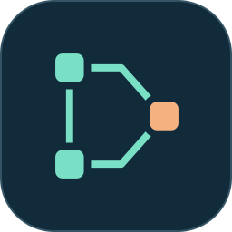

<p align="center">
  
</p>
<h1 align="center">dsh-incremental</h1>

<p align="center">
  <a href="README.md">简体中文</a> · <strong>English</strong>
</p>

<p align="center">
  <a href="package.json"></a>
  <a href="docs/compatibility.md"></a>
  <a href="package.json"></a>
  <a href="LICENSE"></a>
</p>

<p align="center">
  <strong>Reuse eligible review results. Rerun the tasks affected by change.</strong><br>
  Read-only AI incremental review for DeepSeek Harness.
</p>

<p align="center">
  <a href="#quick-start"></a>
  <a href="#how-it-works"></a>
  <a href="docs/usage.md"></a>
  <a href="https://github.com/hg1048596-pixel/dsh-incremental/issues"></a>
</p>

---

dsh-incremental splits code review into tasks with explicit dependencies and records each task's inputs and results. After a module changes, it reruns the affected tasks and their downstream tasks, keeping the other results that qualify for reuse.

- **Incremental execution**: declare files, directories, and upstream dependencies to determine what needs to run again.
- **Explainable reuse**: reports record input changes, cache age, model routes, and the status of each task.
- **Resume after interruption**: save independent task results and recheck inputs and upstream state when resuming.
- **Read-only review**: read declared inputs without executing code or scripts from the target repository.

<a id="how-it-works"></a>

## How it works

<p align="center">
  
</p>

The diagram shows `visible-model` mode with all reuse checks passing. Every task result retains its provenance; changed inputs or upstream results trigger a fresh review.

<a id="quick-start"></a>

## Installation

With DSH and Node.js 24.9+ available, package and install from this project directory:

```powershell
npm pack --ignore-scripts
dsh plugin --profile incremental-demo add C:\path\dsh-incremental-0.1.0.tgz
```

Replace the path with the generated `.tgz` file. Continue with the configuration below, or follow the [full usage guide](docs/usage.md) to connect the plugin to a DSH session.

## Configure and run

Copy the [configuration template](examples/dsh-config.example.json) outside the repository, for example to `C:\private\review-config.json`, and set:

| Field | Value |
| --- | --- |
| `runtimeRoot` | The existing DSH runtime directory containing `package.json` and `node_modules`. |
| `approvedRepoRoot` | The absolute path of the repository to review, such as `C:\work\sample`. |
| `model`, `connection` | The model, adapter, and API endpoint to use. |
| `credentialEnv` | The environment variable containing the API key; the template uses `DEEPSEEK_API_KEY`. |
| `allowRemote` | Set to `true` after authorizing the declared inputs to be sent to the configured model. |

Supply the key to the process through the environment variable. Use the [task example](examples/demo-repo/review-tasks.json) to create `C:\private\review.json`, declaring each task's inputs, review requirements, and `dependsOn`. Input paths are relative to the target repository. Directory inputs include hidden and untracked files; `.gitignore` is not applied automatically.

The default cache policy is `strict`: an unverifiable model revision prevents reuse across runs. The template explicitly selects `visible-model` with a 24-hour TTL, allowing short-term reuse based on visible model metadata; undisclosed server updates under the same model ID may go undetected. Use `--full` to rerun everything. See [cache configuration](docs/usage.md).

Run from this project directory with your own paths. Keep the state directory outside the target repository:

```powershell
$reviewArgs = @(
  '--repo', 'C:\work\sample',
  '--manifest', 'C:\private\review.json',
  '--state', 'C:\review-state',
  '--dsh-config', 'C:\private\review-config.json'
)
node bin/dsh-incremental.js plan @reviewArgs
node bin/dsh-incremental.js run @reviewArgs
node bin/dsh-incremental.js run @reviewArgs --full
node bin/dsh-incremental.js report --repo C:\work\sample --state C:\review-state
```

`plan` shows tasks and invalidation reasons, `run` performs the review, and `report` reads a saved report. In `visible-model` mode, `plan` also queries model metadata from the authorized endpoint. See the [usage guide](docs/usage.md) for resuming, JSON exports, and DSH patch configuration.

## Use from DSH

Follow the [host configuration guide](docs/usage.md) to set the repository, task manifest, state directory, and model route, then start DSH:

```powershell
dsh --profile incremental-demo --patch C:\private\incremental.yml
```

| Tool | Purpose |
| --- | --- |
| `incremental_plan` | Show which tasks need to run and why. |
| `incremental_run` | Run the review; pass `full: true` to force a full run. |
| `incremental_report` | Pass `runId` to read the corresponding report. |

## Documentation

- [Usage guide](docs/usage.md): configuration, manifests, cache policies, resuming, and DSH integration.
- [Core functionality and examples](docs/core-functionality.md) · [Compatibility and runtime](docs/compatibility.md)
- [Permission-read performance](docs/permission-performance.md) · [Release checks](docs/release-readiness.md)
- [Experiment and acceptance records](docs/experiment-protocol.md) · [Acceptance evidence](docs/evidence/README.md)

Detailed documentation is currently in Chinese.

## Development

```powershell
npm test
node bin/dsh-incremental.js doctor --json
node bin/dsh-incremental.js demo --output artifacts/demo
```

`doctor` checks the existing runtime. `demo` demonstrates the workflow with an offline rule-based executor. The core API exports `runReview` and `planReview` from `dsh-incremental/core`.

[GitHub test runs](https://github.com/hg1048596-pixel/dsh-incremental/actions/workflows/test.yml) · [Report an issue](https://github.com/hg1048596-pixel/dsh-incremental/issues) · [MIT License](LICENSE)
