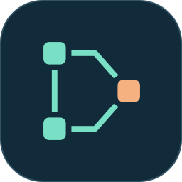
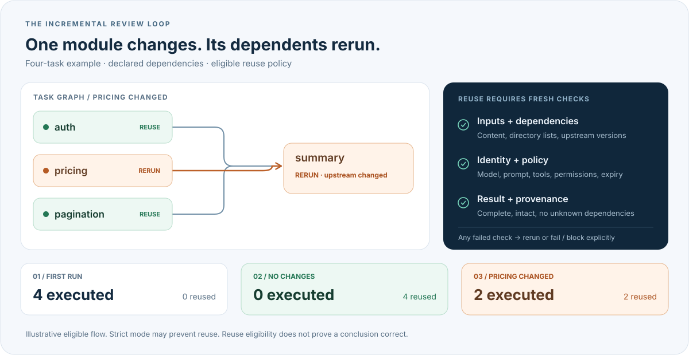

<p align="center">
  
</p>
<h1 align="center">dsh-incremental</h1>

<p align="center">
  <strong>简体中文</strong> · <a href="README.en.md">English</a>
</p>

<p align="center">
  <a href="package.json"></a>
  <a href="docs/compatibility.md"></a>
  <a href="package.json"></a>
  <a href="LICENSE"></a>
</p>

<p align="center">
  <strong>复用仍然有效的审查结果，只重跑受变化影响的任务。</strong><br>
  DeepSeek Harness 的只读 AI 增量审查插件。
</p>

<p align="center">
  <a href="#quick-start"></a>
  <a href="#how-it-works"></a>
  <a href="docs/usage.md"></a>
  <a href="https://github.com/hg1048596-pixel/dsh-incremental/issues"></a>
</p>

---

dsh-incremental 将代码审查拆成有依赖关系的任务，记录每项任务的输入与结果。修改一个模块后，重新执行受影响的任务及其下游，保留其余符合条件的结果。

- **按任务增量执行**：声明文件、目录和上游依赖，自动计算需要重跑的范围。
- **看得见的复用原因**：报告记录输入变化、缓存期限、模型路线和逐任务执行状态。
- **中断后恢复**：保存独立任务的结果，恢复时重新核对输入与上游状态。
- **只读审查**：读取声明的输入，不执行目标仓库的代码或脚本。

<a id="how-it-works"></a>

## 工作方式

<p align="center">
  
</p>

上图展示启用 `visible-model` 且复用检查通过时的流程。每项任务的结果都保留来源；输入或上游结果变化时，对应任务重新审查。

<a id="quick-start"></a>

## 安装

准备好 DSH 和 Node.js 24.9+，在本项目目录打包并安装：

```powershell
npm pack --ignore-scripts
dsh plugin --profile incremental-demo add C:\path\dsh-incremental-0.1.0.tgz
```

将路径替换为生成的 `.tgz` 文件。接着完成下方配置，或按[完整使用指南](docs/usage.md)将插件接入 DSH 会话。

## 配置与运行

将[配置模板](examples/dsh-config.example.json)复制到仓库外，例如 `C:\private\review-config.json`，并设置：

| 字段 | 内容 |
| --- | --- |
| `runtimeRoot` | 已有 DSH 安装中包含 `package.json` 和 `node_modules` 的运行时目录。 |
| `approvedRepoRoot` | 要审查的仓库绝对路径，如 `C:\work\sample`。 |
| `model`、`connection` | 使用的模型、适配器和 API 地址。 |
| `credentialEnv` | 保存 API 密钥的环境变量名，模板为 `DEEPSEEK_API_KEY`。 |
| `allowRemote` | 确认允许向所配模型发送声明的输入后，设为 `true`。 |

通过环境变量向进程提供密钥。参考[任务示例](examples/demo-repo/review-tasks.json)编写 `C:\private\review.json`，声明各任务的输入、审查要求和 `dependsOn`。输入路径相对于被审查仓库；目录输入包含隐藏文件和未跟踪文件，不自动应用 `.gitignore`。

默认缓存策略为 `strict`：无法核实模型版本时不跨运行复用。模板显式选择 `visible-model` 并设置 24 小时 TTL，允许按可见模型信息短期复用；同一模型 ID 下未公开的服务端更新可能无法检测。随时用 `--full` 全量重跑。详见[缓存策略](docs/usage.md)。

在本项目目录运行，将以下路径换成自己的配置；状态目录放在被审查仓库外：

```powershell
$reviewArgs = @(
  '--repo', 'C:\work\sample',
  '--manifest', 'C:\private\review.json',
  '--state', 'C:\review-state',
  '--dsh-config', 'C:\private\review-config.json'
)
node bin/dsh-incremental.js plan @reviewArgs
node bin/dsh-incremental.js run @reviewArgs
node bin/dsh-incremental.js run @reviewArgs --full
node bin/dsh-incremental.js report --repo C:\work\sample --state C:\review-state
```

`plan` 查看任务与失效原因，`run` 执行审查，`report` 读取已保存报告。`visible-model` 模式的 `plan` 也会查询已授权端点的模型元数据。恢复运行、JSON 导出及 DSH patch 配置见[使用指南](docs/usage.md)。

## 在 DSH 中使用

按[宿主配置说明](docs/usage.md)固定仓库、任务清单、状态目录和模型路线，然后启动 DSH：

```powershell
dsh --profile incremental-demo --patch C:\private\incremental.yml
```

| 工具 | 用途 |
| --- | --- |
| `incremental_plan` | 查看需要执行的任务及原因。 |
| `incremental_run` | 执行审查；传入 `full: true` 强制全量执行。 |
| `incremental_report` | 传入 `runId`，读取对应报告。 |

## 文档

- [使用指南](docs/usage.md)：配置、任务清单、缓存策略、恢复与 DSH 接入。
- [核心功能与示例](docs/core-functionality.md) · [兼容性与运行时](docs/compatibility.md)
- [权限读取性能](docs/permission-performance.md) · [发布检查](docs/release-readiness.md)
- [实验与验收记录](docs/experiment-protocol.md) · [验收证据](docs/evidence/README.md)

## 开发

```powershell
npm test
node bin/dsh-incremental.js doctor --json
node bin/dsh-incremental.js demo --output artifacts/demo
```

`doctor` 检查已有运行时，`demo` 使用离线规则执行器演示流程。核心 API 从 `dsh-incremental/core` 导出 `runReview` 和 `planReview`。

[GitHub 自动测试](https://github.com/hg1048596-pixel/dsh-incremental/actions/workflows/test.yml) · [提交问题](https://github.com/hg1048596-pixel/dsh-incremental/issues) · [MIT License](LICENSE)
